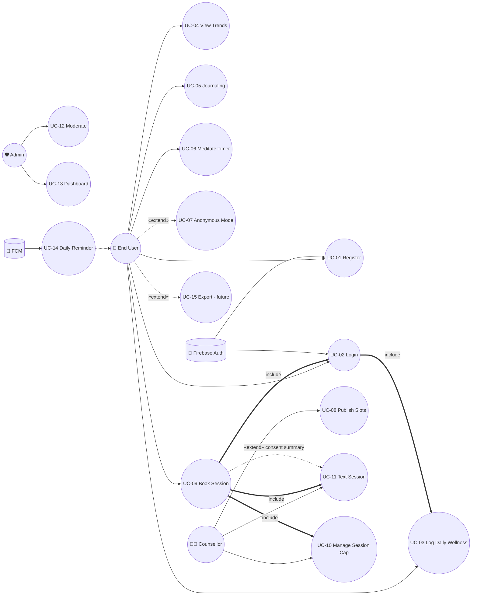

# Session 5: UML Use Case Modeling

| Field | Details |
|---|---|
| **Course** | Software Development Project (SDP) |
| **Session** | 5 |
| **Topic** | UML Use Case Modeling |
| **Tools** | StarUML / Draw.io *(diagram drafted for draw.io; rendered below as embedded diagram for the repository)* |
| **Deliverable** | Use Case Diagram and Narratives |
| **Industry Mapping** | Requirement Modeling |
| **Project Domain** | HealthCare |
| **Project Title** | Eunoia — Healthcare & Mental Wellness Platform |
| **GitHub Repository** | https://github.com/HarshBhardwaj00/Eunoia |
| **Input from Session 4** | FR-01…FR-23 (SRS) → grouped into use cases below |

---

## Objective

To model Eunoia's behavior from the **users' viewpoint** using UML use cases: identify
actors and use cases, draw the use case diagram with correct `<<include>>` /
`<<extend>>` relationships, and write full **use case narratives** (description
templates) for the critical flows — the classic industry step of requirement modeling.

**Learning Outcomes:**
1. Identify actors and use cases from an SRS.
2. Draw a UML use case diagram with associations, includes and extends.
3. Document use cases in a standard narrative/description template.

---

## Part A: Use Case Identification

### Actors (from SRS RBAC roles + external services)

| Actor | Type | Description |
|---|---|---|
| **End User** | Primary | Student/professional who logs wellness, uses self-care tools, books sessions (FR §3.1–3.5, §3.8) |
| **Counsellor** | Primary | Volunteer who publishes slots, conducts text sessions (FR §3.6) |
| **Admin** | Primary | Moderates counsellors, views anonymized dashboard (FR §3.7) |
| reminder-service (Firebase FCM) | Secondary | External system that delivers the daily reminder (FR-23) |
| auth-service (Firebase Auth) | Secondary | External system performing verification/authentication (FR-01…04) |

### Use case list (grouping SRS FRs)

| Use Case ID | Use Case Name | Actor(s) | SRS trace |
|---|---|---|---|
| UC-01 | Register Account | End User, auth-service | FR-01, FR-02 |
| UC-02 | Login / Authenticate | End User, Counsellor, Admin, auth-service | FR-03, FR-04 |
| UC-03 | Log Daily Wellness | End User | FR-05, FR-06, FR-07 |
| UC-04 | View Trend Charts | End User | FR-08, FR-09 |
| UC-05 | Practice Journaling | End User | FR-10 |
| UC-06 | Meditate with Timer | End User | FR-11, FR-12 |
| UC-07 | Toggle Anonymous Mode | End User | FR-13 |
| UC-08 | Publish Availability Slots | Counsellor | FR-16 |
| UC-09 | Book Counselling Session | End User | FR-17, FR-18 |
| UC-10 | Manage Session Cap | Counsellor | FR-19 (auto-warn/block) |
| UC-11 | Conduct Text Session | End User, Counsellor | FR-20, FR-14 |
| UC-12 | Moderate Counsellors | Admin | FR-21 |
| UC-13 | View Usage Dashboard | Admin | FR-22 |
| UC-14 | Send Daily Reminder | reminder-service, End User | FR-23 |
| UC-15 | Export My Data | End User | FR-15 (**future v1.1 — modeled, not built**) |

---

## Part B: Use Case Diagram Creation

*Drafted per UML 2.x conventions — system boundary = Eunoia v1; primary actors left,
secondary actors right; `<<include>>` = mandatory sub-flow, `<<extend>>` = optional
variation.*

```
                     ┌─────────────────────────────────────────────────────┐
                     │                   Eunoia (v1)                       │
                     │                                                     │
   ┌──────────┐      │   (UC-01 Register)  (UC-02 Login)   (UC-03 Log      │
   │ End User ├─●────┼────────────────────────────┐    Daily Wellness)    │
   └────┬─────┘      │        ▲                   │           ▲           │
        │            │        │<<include>>        │<<include>>│           │
        ●────────────┼────(UC-04 View Trends)─(UC-02)───┐ │           │
        ●────────────┼────(UC-05 Journaling)            │ │           │
        │            │                                  │ │           │
        │            │   (UC-06 Meditate Timer)         │ │           │
        ●────────────┼──────────────────────────────────┘ │           │
        │            │                                    │           │
        ●────────────┼────(UC-07 Anonymous Mode ‹extend›─┘ │           │
        │            │   (UC-09 Book Session)<<include>>(UC-02)        │
        ●────────────┼──────────┐            ‹extend›: (UC-14 Reminder)   │
        │            │          │<<include>>(UC-11 Text Session)          │
        │            │          │<<include>>(UC-10 Cap Guard)             │
        │            │          │ ‹extend› (UC-15 Export • future)        │
   ┌────┴───────┐    │          ▼                                         │
   │ Counsellor ├────┼──(UC-08 Publish Slots)──(UC-11 Text Session)       │
   └────┬───────┘    │                │                                   │
        │            │        ‹extend›(consent-based summary sharing)     │
   ┌────┴─────┐      │                                                    │
   │  Admin   ├──────┼──(UC-12 Moderate Counsellors)──(UC-13 Dashboard)   │
   └────┬─────┘      │                                │                   │
        │            └────────────────────────────────┼───────────────────┘
        │<─────anonymized aggregates, no PII──────────┘
   [FCM / Auth] ←── secondary (system) actors deliver UC-14, supply UC-02
```

*Simplified for print; the draw.io source file can be committed later alongside this
narrative. Below, the same model as an embedded diagram (renders in the GitHub repo):*



**Relationships explained (commonly asked in review):**
- `<<include>>` — UC-09 *Book Session* must always pass UC-02 *Login* and by design
  always routes through UC-11 *Text Session* and cap-guard UC-10.
- `<<extend>>` — UC-07 *Anonymous Mode* is an optional variation of normal usage;
  UC-14 reminder triggers **only when a check-in is missed** (extension point);
  consent-based summary sharing is an optional extension of UC-11.

---

## Part C: Use Case Description Templates (Narratives)

### UC-09 — Book Counselling Session  ★ (most critical; fully detailed)

| Field | Description |
|---|---|
| **Use Case ID / Name** | UC-09 / Book Counselling Session |
| **Actors** | Primary: End User · Secondary: auth-service (FR-03) |
| **Description** | User reserves an available text-session slot with a student counsellor. |
| **Preconditions** | User authenticated (UC-02); at least one active slot exists (UC-08). |
| **Postconditions** | Slot marked booked; booking record stored; cacellations allowed until session start. |
| **Trigger (Event flow)** | User opens "Find a counsellor" screen. |

**Main Success Scenario (Basic Flow):**
1. User browses counsellors (verified, active).
2. User selects a counsellor and an available slot.
3. System re-checks slot status and cap (UC-10 include).
4. User optionally pre-selects **what summary to share** (FR-14; default none).
5. User confirms → system marks slot `booked` atomically (FR-17).
6. System shows confirmation with date/time to both user and counsellor.
7. Use case ends; conversation surface of UC-11 becomes reachable.

**Alternative Flows / Extensions:**
- **A1 (3a)** — slot already taken → system refreshes list, no booking (extends: race).
- **A2 (4a)** — user skips summary → proceed with share = none.
- **A3 (3b)** — counsellor cap reached → block with a clear message (UC-10 behavior).
- **A4 (*)**  — user cancels booking any time before the session → slot freed.

| Field | Description |
|---|---|
| **Business Rules** | FR-17 double-booking prevention · FR-19 cap (warn @1, block @2/day) · FR-14 consent-based sharing |
| **Non-functional criteria** | Booking confirmed < 2 s (NFR-02); screen reachable in ≤ 3 taps (NFR-03). |
| **Issues / open questions** | Should users see counsellor ratings? *(deferred — not in v1 scope)* |

### UC-03 — Log Daily Wellness

| Field | Description |
|---|---|
| **ID / Name / Actors** | UC-03 / Log Daily Wellness / End User (primary), FCM (indirect) |
| **Description** | Record today's mood, sleep hours and stress in a single screen. |
| **Preconditions** | Authenticated (UC-02). |
| **Postconditions** | One serialized entry exists for today (FR-07). |
| **Basic flow** | 1) Open logger → 2) tap mood level → 3) adjust sleep/stress sliders → 4) Save → 5) confirmation + streak nudge. |
| **Alternative flows** | Repeat same day → updates today's record (FR-07); offline → queued (NFR-04), synced later. |
| **Business rules / NFRs** | FR-05 field limits · ≤ 1 min, ≤ 3 taps (NFR-03) · owner-only access (FR-06). |
| **Issues** | Mood scale emoji design to be finalized in UI design session. |

### UC-12 — Moderate Counsellors (Admin)

| Field | Description |
|---|---|
| **ID / Name / Actors** | UC-12 / Moderate Counsellors / Admin (primary) |
| **Description** | Verify or remove a counsellor from the public list. |
| **Preconditions** | Admin role session (FR-03); counsellor account exists. |
| **Postconditions** | Listing state updated; action appended to admin action log (FR-21). |
| **Basic flow** | 1) Open moderation queue → 2) review counsellor profile → 3) approve/reject → 4) system logs action with timestamp. |
| **Alternative flows** | Counsellor already booked by users when removed → their future slots are deactivated, existing bookings honoured. |
| **Business rules** | FR-21 admin-only + action log; anonymized, no PII exposure (FR-22). |
| **Issues** | Verification criterion (college wellness cell vetting) to be drafted with institution. |

*(Narrative template shown fully on 3 use cases; remaining UCs use the same fields —
kept compact for brevity in the record, available on request during review.)*

---

## Deliverable — Use Case Diagram and Narratives (Evidence Summary)

| Checklist item | Status |
|---|---|
| Actors identified (3 primary + 2 secondary) with SRS trace (Part A) | ✅ |
| 15 use cases identified & mapped to FRs FR-01…FR-23 (Part A) | ✅ |
| Use case diagram drawn with system boundary, `<<include>>`/`<<extend>>` (Part B) | ✅ |
| Full narratives (UC-09, UC-03, UC-12) in standard template + reusable template (Part C) | ✅ |
| Tools noted (StarUML/Draw.io draft + rendered diagram in repo) | ✅ |
| Deliverable added to repository `SDP-Sessions/` folder | ✅ *(added locally this session)* |

---

## Industry Mapping — Requirement Modeling

| Our SDP practice | Industry equivalent |
|---|---|
| Actors/use cases derived from SRS FRs | UML use case modeling in requirement phase (RUP/Agile Hybrid) |
| `<<include>>`/`<<extend>>` discipline | Requirement-scoping rehearsal before sprint planning |
| Narrative templates (pre/post, main/alt flows) | Test-case seeds: QA converts alt-flows directly into test matrices |
| Diagram in repo + tool source files | Docs-as-code + design assets versioned alongside code (draw.io XML in Git) |
| Traceability UC-xx ↔ FR-xx ↔ US-xx | Full Requirements Traceability Matrix (RTM): stakeholder → story → FR → UC → test |

**Why use case modeling in reality:** customers rarely read 23 numbered FRs, but they
immediately review *Book a session* flows and catch missing scenarios (privacy of
shared summary, race on the last slot). Use case reviews are the **cheapest bug
prevention** in the lifecycle — the same reason product teams still do them.

---

## Conclusion

Session 5 modeled Eunoia from the user's perspective: 3 primary + 2 secondary actors,
15 use cases traced to every SRS functional requirement, a UML use case diagram with
correct include/extend semantics (diagram embedded, tool source noted), and full
narratives for the three most critical use cases including booking with
consent-based privacy sharing. These verified flows become the direct input for the
next session's **architecture, sequence diagrams and database design**.
