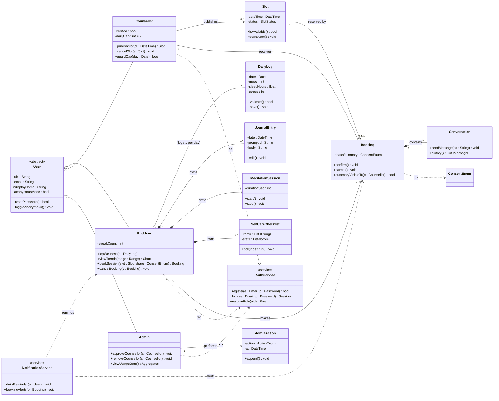

# Session 6: UML — Class Diagram Design

| Field | Details |
|---|---|
| **Course** | Software Development Project (SDP) |
| **Session** | 6 |
| **Topic** | UML — Class Diagram Design |
| **Deliverable** | Class Diagram |
| **Industry Mapping** | Object-Oriented System Design |
| **Project Domain** | HealthCare |
| **Project Title** | Eunoia — Healthcare & Mental Wellness Platform |
| **GitHub Repository** | https://github.com/HarshBhardwaj00/Eunoia |
| **Input from Sessions 4–5** | SRS data entities (§5.2) + use cases (UC-01…UC-15) → OO design classes |

---

## Objective

To perform **object-oriented analysis (OOA)** of Eunoia and design a **UML class
diagram**: identifying classes from SRS data entities and use-case behaviors, defining
attributes and methods, and specifying relationships (association, multiplicity,
aggregation, composition, inheritance, dependency) — the industry step of
**object-oriented system design**, between requirements and actual coding.

**Learning Outcomes:**
1. Apply OO analysis (noun/verb method) to derive candidate classes.
2. Define attributes, methods, visibility and responsibilities per class.
3. Model inter-class relationships with correct UML notation and multiplicities.

---

## Part A: Object-Oriented Analysis (Class Discovery)

**Technique used — noun/verb analysis** of the problem statement and use-case flows
(industry practice from "Applying UML and Patterns", G. Larman):

| OO concept | Source examples from our artifacts | Candidate result |
|---|---|---|
| **Nouns → candidate classes/objects** | "user", "counsellor", "mood entry", "slot", "booking", "journal entry", "admin action" | `User`, `Counsellor`, `Admin`, `DailyLog`, `Slot`, `Booking`, `JournalEntry`, `MeditationSession` |
| **Nouns that are properties → attributes** | "mood level", "sleep hours", "date", "consent flag" | attributes of `DailyLog`, `Booking` |
| **Verbs → responsibilities/methods** | "logs wellness", "publishes slot", "books", "moderates", "sends reminder" | `saveEntry()`, `publishSlot()`, `book()`, `approveCounsellor()`, `remind()` |
| **Domain rules → invariants** | "slot cannot be booked twice" (FR-17), "cap 2/day" (FR-19) | methods `isAvailable()`, `guardCap()` inside classes |
| **Cross-cutting services (not entities)** | auth, notifications | `AuthService`, `NotificationService` (dependency usage, not ownership) |

**Filtering applied (OO smell check):** UI-screen classes and vague nouns ("app",
"dashboard") were rejected; Firestore keeps data as documents, so entities were
designed as **domain classes that serialize to those documents**.

---

## Part B: Class Identification — Attributes, Methods & Relationships

### Class inventory

| Class | Key attributes (visibility) | Key methods | Design note |
|---|---|---|---|
| **User** *(abstract-ish base)* | `– uid: String` · `– email: String` · `# displayName: String` · `– anonymousMode: bool` | `+ resetPassword()` · `+ toggleAnonymous() · + exportData()` | Parent of all role classes (RBAC) |
| **EndUser** *(extends User)* | `– streakCount: int` · `– dailyCap awareness none` | `+ logWellness(d) · + viewTrends(range) · + bookSession(slot, shareSummary) · + cancelBooking(b)` | Actor "End User" |
| **Counsellor** *(extends User)* | `– verified: bool` · `– dailyCap: int = 2` | `+ publishSlot(dt) · + cancelSlot(s) · + openSession(b) · + guardCap(day)»bool` | FR-16, FR-19 |
| **Admin** *(extends User)* | `– actionLogRef` | `+ approveCounsellor(c) · + removeCounsellor(c) · + viewUsageStats()»Aggregates` | FR-21, FR-22 |
| **DailyLog** | `– date: String` · `– mood: int(1..5)` · `– sleepHours: float(0..14)` · `– stress: int(1..5)` | `+ validate() · + save()` | One/(user·day) — FR-05..07 |
| **JournalEntry** | `– date: ts` · `– promptId: String` · `– body: Secret text` | `+ create() · + edit() · + list()` | FR-10 |
| **MeditationSession** | `– durationSec: int` · `– completedOn: ts` | `+ start() · + stop() · + logDuration()` | FR-11 |
| **SelfCareChecklist** | `– items[] · – state[]` | `+ tick(i) · + persist()` | FR-12 |
| **Slot** | `– id · – dateTime: ts · – status: {available, booked, deactivated}` | `+ isAvailable()»bool · + deactivate()` | FR-16 |
| **Booking** | `– id · – userUid · – slotRef · – shareSummary: ConsentEnum{none, brief, full}` | `+ confirm() · + cancel() · + summaryVisibleTo(counsellor)»bool` | FR-14, FR-17, FR-18 |
| **Conversation** *(part of Booking)* | `– bookingRef · – messages[]` | `+ sendMessage(txt) · + history()` | FR-20 |
| **AdminAction** | `– adminUid · – action · – targetUid · – at: ts` | `+ append()` | FR-21 audit trail |
| **AuthService** *(service)* | stateless | `+ register() · + verify() · + login() · + resolveRole()»Role` | FR-01..04 (dependency) |
| **NotificationService** *(service)* | stateless | `+ dailyReminder(user) · + bookingAlerts()` | FR-23 (dependency) |

### Relationships decided (with multiplicities)

| Relationship | UML form | Rationale (trace) |
|---|---|---|
| `User` ← `EndUser / Counsellor / Admin` | Generalization (inheritance) | RBAC roles share identity core (FR-03) |
| `EndUser ◇— DailyLog` | Aggregation 1..* per user (1 per day) | Logs exist independently per entry; user owns the set (FR-06) |
| `EndUser ◇— JournalEntry` | Composition 0..* | Entries cannot exist without their user's account (privacy cascade) |
| `EndUser ◇— MeditationSession / SelfCareChecklist` | Composition 0..* | Same lifecycle |
| `Counsellor 1 — 0..* Slot` | Association | FR-16 slots belong to one counsellor |
| `Slot 1 — 0..1 Booking` | Association | FR-17 invariant: max one active booking per slot |
| `Booking 1 — 1 Conversation` | Composition | Conversation exists only within a booking (FR-20) |
| `EndUser — Booking`, `Counsellor — Booking` | Association (0..* / 1 buyer side) | Who booked, with whom |
| `Admin — AdminAction` | Association 1..* | FR-21 audit |
| `EndUser ..> AuthService`, `..> NotificationService` | Dependency | Services used, never owned |
| `Booking ..> ConsentEnum` | Dependency | Controlled vocabulary for FR-14 |

---

## Part C: UML Class Diagram Modeling

*Rendered diagram (GitHub renders Mermaid natively); StarUML .mdj source can be
committed alongside later:*

**Multiplicities summary (asked in viva):** `User 1 → DailyLog 1/day ·
Counsellor 1 → Slot 0..* · Slot 1 → Booking 0..1 · Booking 1 → Conversation 1 ·
Admin 1 → AdminAction *`

**Pattern notes (good OO design):**
- `Slot.isAvailable()` + booking creation wrapped in one screen-level check → keeps the
  **FR-17 double-booking invariant** (Firestore transaction ENFORCED at save time).
- Consent logic centralized in `Booking.summaryVisibleTo()` → FR-14 lives in **one
  place**, not sprinkled across UIs.
- Services kept **stateless dependencies** → testable, mirror to Firebase SDK wrappers.

---

## Deliverable — Class Diagram (Evidence Summary)

| Checklist item | Status |
|---|---|
| OO analysis done — noun/verb technique with filtering (Part A) | ✅ |
| 13 classes with attributes, methods, visibility documented (Part B) | ✅ |
| Relationships with multiplicity, aggregation/composition/inheritance/dependency (Part B) | ✅ |
| UML class diagram modeled & rendered in repository (Part C) | ✅ |
| Traceability to SRS FRs & use cases maintained (all tables) | ✅ |
| Deliverable added to repository `SDP-Sessions/` folder | ✅ *(added locally this session)* |

---

## Industry Mapping — Object-Oriented System Design

| Our SDP practice | Industry equivalent |
|---|---|
| Noun/verb analysis | UML/RUP domain modeling, CRC card sessions |
| Class inventory with visibility | Design review artifacts reviewed by tech leads |
| Multiplicity + invariant per association | Persistence design review (schema contract) |
| Invariants guarded in owning class | "Make illegal states unrepresentable" OO principle |
| Diagram-as-code in repo | Design docs versioned beside code (C4Model/PlantUML/Mermaid cultures) |
| Traceability FR → UC → Class → method | RTM extended to design — every requirement lands in code somewhere |

**Business reality:** at companies like ours-in-the-making, the class diagram is the
**shared language** between backend + frontend + QA: Flutter devs derive models &
Firestore security rules from it, testers turn invariants (FR-17/FR-14) into tests,
and reviewers verify every requirement maps to at least one method.

---

## Conclusion

Session 6 converted Eunoia's requirements into a strong object-oriented design:
noun/verb analysis discovered 13 domain/service classes, attributes and methods were
defined with visibility, and relationships (inheritance for RBAC, composition for
private user data, invariant-enforcing associations for slots/bookings, dependencies
for services) were modeled in a rendered UML class diagram fully traceable to the SRS.
The natural next session extends this into **sequence diagrams for key flows and
system architecture + database schema**, and then implementation begins.
