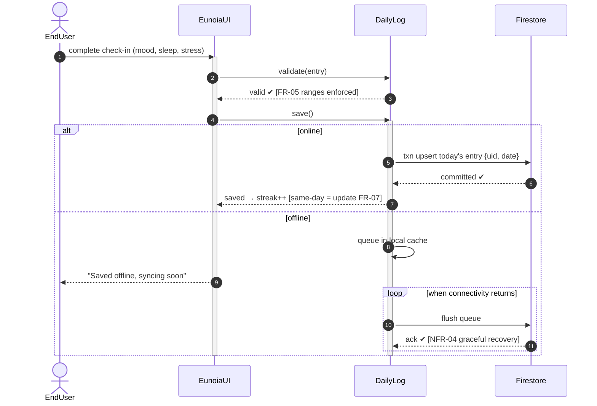
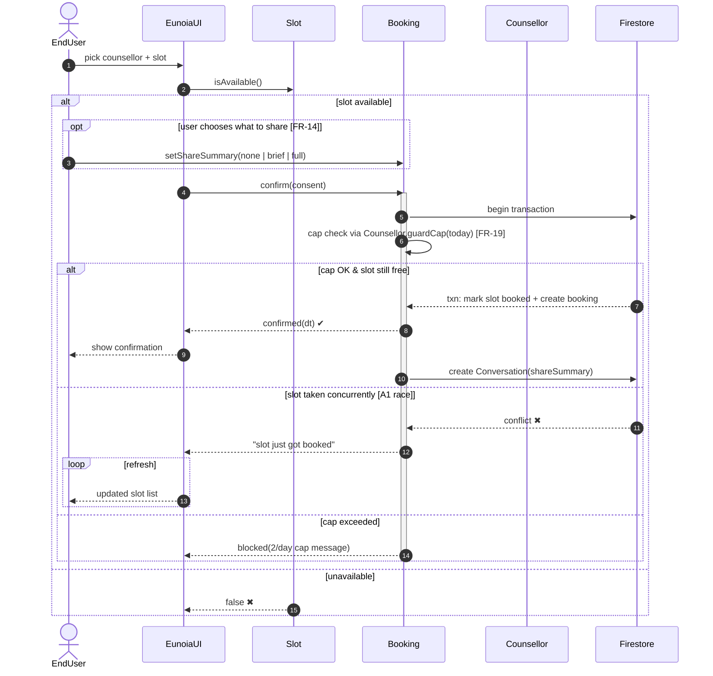
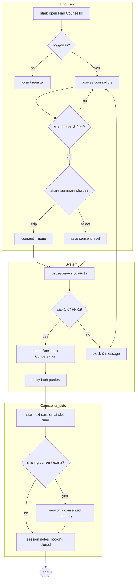
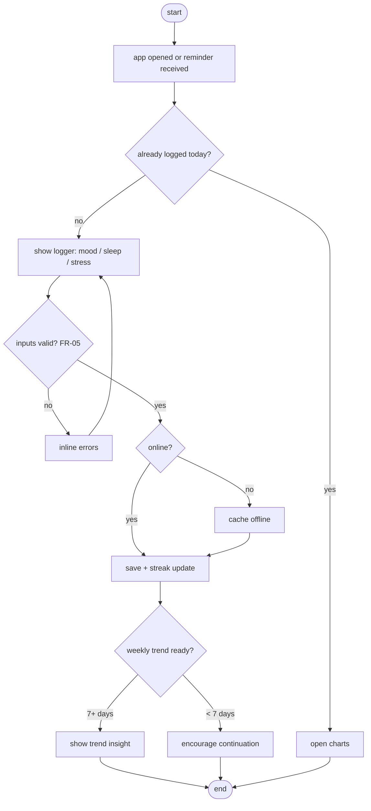

# Session 7: UML — Sequence and Activity Diagram Modeling

| Field | Details |
|---|---|
| **Course** | Software Development Project (SDP) |
| **Session** | 7 |
| **Topic** | UML — Sequence and Activity Diagram Modeling |
| **Deliverable** | Sequence and Activity Diagram |
| **Industry Mapping** | Interaction and Workflow Modeling |
| **Project Domain** | HealthCare |
| **Project Title** | Eunoia — Healthcare & Mental Wellness Platform |
| **GitHub Repository** | https://github.com/HarshBhardwaj00/Eunoia |
| **Input from Sessions 5–6** | Use cases (UC-02, UC-03, UC-09, UC-11) + domain classes → interaction & workflow models |

---

## Objective

To design **interaction-level and workflow-level UML models** for Eunoia's critical
scenarios: **sequence diagrams** showing the exact message exchanges (time-ordered)
between UI, services and domain objects, and **activity diagrams** modeling business
workflows with decisions, parallel paths and swimlanes — closing the gap between the
class design (Session 6) and implementation.

**Learning Outcomes:**
1. Design sequence diagrams with lifelines, activations and message types.
2. Represent message flow precisely (sync/async, returns, `alt`/`opt`/`loop` fragments).
3. Model workflows using activity diagrams with decision nodes and swimlanes.

---

## Part A: Sequence Diagram Design

**Selection of critical flows (design decision):** the three highest-risk /
highest-value interactions, taken from Session 5's narratives and Session 6's classes

| Scenario | Source | Why modeled first |
|---|---|---|
| SD-01 Login & Role Resolution | UC-02 · FR-01..04 · `AuthService` | Gateway to every other flow |
| SD-02 Daily Wellness Log Save | UC-03 · FR-05..07 · `DailyLog` | Most used path; offline case is a real risk (NFR-04) |
| SD-03 Book Counselling Session | UC-09/10/11 · FR-14,17,18,19 · `Slot`, `Booking` | Concurrency (double-booking) + privacy consent — the highest-risk flow |

**Lifeline set derived from class diagram (no new objects invented):**
`EndUser ↔ EunoiaUI ↔ AuthService / Firestore ↔ Domain classes (DailyLog, Slot, Booking) ↔ NotificationService`.

---

## Part B: Message Flow Representation

**Notation duty-check (what messages we use and mean):**

| Symbol | Meaning | Where we used |
|---|---|---|
| solid arrow filled head `→` | **synchronous** call, waits for return | UI → domain/save calls |
| half/return arrow `-->` | reply/return value | validation results, data loads |
| open-head arrow `→` (async in text) | **asynchronous** fire-and-forget | FCM reminder dispatch |
| `alt / else` fragment | branching | slot free vs taken; online vs offline |
| `opt` fragment | optional block | consent summary selection |
| `loop` fragment | repetition | slot list re-render |
| activation bar | object is executing | save in progress |

### SD-01 — Login & Role Resolution

```mermaid
sequenceDiagram
    autonumber
    actor U as EndUser
    participant UI as EunoiaUI
    participant Auth as AuthService
    participant FB as Firestore
    participant NS as NotificationService

    U->>UI: open app
    UI->>Auth: login(email, password)
    activate Auth
    Auth->>FB: query credentials (TLS)
    alt credentials valid & email verified
        FB-->>Auth: user doc {uid, role}
        Auth-->>UI: session(role) ✔
        deactivate Auth
        alt role == "EndUser"
            UI->>UI: render dashboard (home)
        else role == "Counsellor"
            UI->>UI: render slot management
        else role == "Admin"
            UI->>UI: render moderation queue
        end
        UI->>NS: scheduleDailyReminder(uid)   [async]
        NS-->>U: (later) 1 gentle reminder/day  [FR-23]
    else invalid or unverified
        FB-->>Auth: reject
        Auth-->>UI: error(msg) ✖   [FR-04 reset offered]
        deactivate Auth
    end
```

### SD-02 — Daily Wellness Log Save (with offline branch)



### SD-03 — Book Counselling Session (double-booking & consent guarded)



*(Same message-flow notation applied; remaining UCs get modeled exactly like this in
design-review sessions — kept compact here.)*

---

## Part C: Workflow Modeling — Activity Diagrams

### AD-01 — End-to-end booking workflow (swimlanes)



### AD-02 — Daily check-in workflow (decision + action flow)



**Workflow coverage check:** both activity diagrams contain decision nodes (`{}`),
rework loops (invalid input → back to logger), parallel/alternative paths (online vs
offline), and swimlane-style responsibility separation — complete workflow notation.

---

## Deliverable — Sequence and Activity Diagram (Evidence Summary)

| Checklist item | Status |
|---|---|
| 3 critical scenarios selected & justified (Part A) | ✅ |
| 3 sequence diagrams with lifelines, activations, sync/async/return messages (Part B) | ✅ |
| `alt` / `opt` / `loop` fragments used & explained (Part B) | ✅ |
| 2 activity diagrams with decisions, loops & swimlanes (Part C) | ✅ |
| Traceability UC-xx / FR-xx maintained on every diagram | ✅ |
| Deliverable added to repository `SDP-Sessions/` folder | ✅ *(added locally this session)* |

---

## Industry Mapping — Interaction and Workflow Modeling

| Our SDP practice | Industry equivalent |
|---|---|
| Sequence diagrams for riskiest flows | Design reviews where backend/QA finalize API contracts |
| `alt` on slot race | Concurrency handling spec the coder implements as transactions |
| Activity diagram with swimlanes | BPMN-style workflow docs handed to both dev and support teams |
| Offline branch modeling | PWA/mobile sync design pattern discussions |
| Diagram-as-code in repo | Living documentation — same PR that changes code changes the design doc |
| Traceability UC/FR ← diagram | RTM extended to interaction level; QA derives test steps from alt-flows |

**Business reality:** in code review, the argument "bro isne race ka case dekha?" dies
instantly when SD-03 already contains the `alt slot taken` branch — these diagrams are
the reason cross-team miscommunication rarely survives past design review.

---

## Conclusion

Session 7 models Eunoia's dynamics: three fully detailed sequence diagrams (login +
role routing, resilient daily log with offline sync, and the concurrency- and
consent-guarded booking flow) using correct message-flow notation, plus two activity
diagrams with decisions and swimlanes covering the booking workflow and daily
check-in workflow. Requirements (FR), use cases (UC) and classes are now connected
through interactions — with modeling complete, the next session's
**system architecture & database schema design** can be drawn directly from these.
