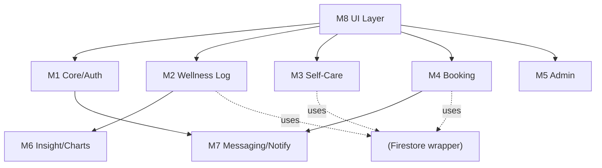

# Session 8: Software Design Principles

| Field | Details |
|---|---|
| **Course** | Software Development Project (SDP) |
| **Session** | 8 |
| **Topic** | Software Design Principles — Modularization, Coupling & Cohesion, Design Approaches |
| **Deliverable** | Design Analysis Report |
| **Industry Mapping** | Software Design Engineering |
| **Project Domain** | HealthCare |
| **Project Title** | Eunoia — Healthcare & Mental Wellness Platform |
| **GitHub Repository** | https://github.com/HarshBhardwaj00/Eunoia |
| **Input from Sessions 6–7** | Class diagram (13 classes) + interaction diagrams → structure quality check |

---

## Objective

To examine **how well Eunoia is structured** — not just what it does: decompose the
system into modules, grade every module on **coupling** (how tangled its connections
are) and **cohesion** (how focused its job is), compare **function-oriented vs
object-oriented** design approaches, and justify a **top-down / bottom-up hybrid**
build strategy — exactly what design engineers do before production coding.

**Learning Outcomes:**
1. Apply modularization to decompose a system into maintainable modules.
2. Analyze coupling and cohesion with industry grading scales.
3. Compare function-oriented and object-oriented design paradigm objectively.
4. Contrast top-down and bottom-up design strategies and select a justified hybrid.

---

## Part A: Modularization

**Principle:** a large system must be split into small, named modules, each owning one
chunk of responsibility with a **clean interface** — so teams build, test and fix parts
independently. Rule of thumb (Parnas): hide the *volatile decisions* inside modules.

### Eunoia's module decomposition (from Session 6 classes + Session 7 flows)

| Module | Contains (classes / packages) | Responsibility | Interface (exposed) |
|---|---|---|---|
| **M1 — Core/Auth** | `User`, `AuthService` | Registration, login, role resolution (FR-01..04) | `Session login()`, `resolveRole()` |
| **M2 — Wellness Log** | `DailyLog` | Daily entry CRUD + validation (FR-05..07) | `save(entry)`, `getRange(dates)` |
| **M3 — Self-Care** | `JournalEntry`, `MeditationSession`, `SelfCareChecklist` | Activities + persistence (FR-10..12) | activity CRUD APIs |
| **M4 — Booking** | `Slot`, `Booking`, `Conversation`, `ConsentEnum` | Slot mgmt, booking txn, cap, consent (FR-14,16..20) | `book(slot, consent)`, `cancel()` |
| **M5 — Admin** | `AdminAction`, aggregates read-only views | Moderation + anonymized stats (FR-21..22) | `moderate()`, `usageStats()` |
| **M6 — Insight/Charts** | trend computation utilities | 7/30-day visualizations (FR-08..09) | `trends(uid, range)` |
| **M7 — Messaging/Notify** | `NotificationService` (FCM wrapper) | reminders + alerts (FR-23) | `schedule()`, `notify()` |
| **M8 — UI Layer** | Flutter screens/widgets (role-gated) | presentation only | — consumes M1..M7 interfaces |

**Guidelines followed:** single-responsibility modules; UI layer holds *no* business
rules; data models are shared via typed interfaces, not leaked internals; every module
can be **unit-tested in isolation** (Firestore behind wrapper interfaces, enabling fake
implementations for tests).

---

## Part B: Coupling and Cohesion Analysis

**Coupling = "how much does breaking module X hurt module Y?" (lower better)**
**Cohesion = "does module X do one coherent job?" (higher better)**

### Coupling grades (low ← best → high) — applied to Eunoia

| Between modules | Type of coupling | Grade | Reasoning / fix |
|---|---|---|---|
| M8 → M1..M7 | **Data coupling** (typed interfaces only) | 🟢 Best | UI passes DTOs, no internals |
| M2/M3/M4 → Firestore wrapper | Data coupling | 🟢 Best | Documents via repository interface |
| M4 → M7 | **Stamp coupling** (Booking object passed for alert) | 🟡 Acceptable | Pass slim `BookingAlert` DTO instead — noted improvement |
| M6 ← M2 | Data coupling (aggregate rows) | 🟢 Best | Trends consume plain data |
| M8 → FCM/Auth SDKs directly | ❌ *Potential* external coupling | 🔴 avoided | All SDK access in M1/M7 wrappers — enforced by code review |
| Any module → global mutable state | Common coupling | 🟢 Zero | No globals — linter rule blocks |

### Cohesion grades (low ← worst → high) — applied to Eunoia

| Module | Cohesion type | Grade | Reasoning |
|---|---|---|---|
| M2 Wellness Log | **Functional cohesion** (one job: daily logging) | 🟢 Best | every method serves logging |
| M4 Booking | Functional | 🟢 Best | slots+booking+consent = one flow |
| M1 Core/Auth | Sequential (verify → role → session) | 🟢 Good | steps of one auth pipeline |
| M3 Self-Care | Cohesional (journaling/meditation grouped) | 🟡 Moderate–good | one "activities" domain; acceptable, split only if growth |
| M5 Admin | Communicational (all actions write one audit log) | 🟡 Good | shares record medium |
| ❌ What we avoided | Coincidental/logical cohesion, e.g., a "utils.dart dumping ground" | — | explicitly banned in lint rules |

**Verdict:** system is **loosely coupled and highly cohesive** in the critical paths
(M2, M4) — the modules Session 7 identified as highest-risk are also the cleanest.

---

## Part C: Function-Oriented vs Object-Oriented Design (applied comparison)

| Aspect | Function-Oriented Design (FOD) | Object-Oriented Design (OOD) | How Eunoia sits |
|---|---|---|---|
| Base unit | Functions/procedures operating on shared/passing data | Objects = data (attributes) + behavior (methods) | OOD primary (Session 6 classes) |
| Data vs behavior | separated | **bundled** (encapsulation) | e.g., `Booking.summaryVisibleTo()` owns consent rule (FR-14) |
| State | global / passed around | encapsulated per object | no global state (see Part B) |
| Reuse | functions, copy-ish | inheritance, composition, interfaces | RBAC hierarchy; Firestore wrapper |
| Security-sensitive data | risky (functions can all touch state) | access-controlled by visibility | private attributes + service boundaries |
| Maintenance | change ripple across functions | change localized in a class | consent change → 1 class |
| Typical systems | batch/utility tasks (e.g., a payroll batch, scientific computation) | interactive, evolving, data-rich systems | mobile app = OOD fit ✅ |
| Limitations in Eunoia | would scatter our double-booking invariant across functions | more unit/session overhead for small utilities | FOD used *inside* small pure helpers (e.g., trend math) |

**Conclusion ≠ religion:** we are **object-oriented where state & security live**
(domain model), and **function-oriented where stateless computation happens**
(pure chart/stat helpers) — pragmatic industry default.

---

## Part D: Top-Down and Bottom-Up Design

| Approach | Meaning | Pros | Cons |
|---|---|---|---|
| **Top-down** | Start from whole system → decompose into modules → details late; global picture first; aligns with requirements | Vision never lost; roadmap-shaped | Late discovery of low-level surprises (API limits, etc.) |
| **Bottom-up** | Build concrete known pieces (components/services) first, then compose upward | Early technical-proof; real integration feedback | Risk of bolt-together system differing from the plan |

### How Eunoia is actually designed (documented strategy)

**Top-down side (already done Sessions 2–7):** problem → requirements → use cases →
classes → interaction models = the descending design path; scope frozen as SRS and
MVP.

**Bottom-up side (the pilot build):**
1. *Base bricks first:* auth wrapper (M1) + log save (M2) — smallest, proven early.
2. *Compose:* M2+M6 (log → chart), M4+M7 (booking → notify).
3. *Note from Firebase decision:* choosing ready **Firebase** services instead of a
   custom backend **is itself bottom-up reuse**: proven bricks, free-tier limits known →
   they forced an explicit architecture constraint (wrapper modules), which the
   top-down model then absorbed cleanly.
4. *De-risked unknowns first:* double-booking txn (highest risk) prototyped before UI polish.

**Chosen: hybrid "risky-brick-first"** — architecture stays top-down; build order is
bottom-up by risk. *(Industry phrase: "spike the scary part early.")*

---

## Deliverable — Design Analysis Report (Evidence Summary)

| Checklist item | Status |
|---|---|
| System decomposed into 8 modules with interfaces (Part A) | ✅ |
| Coupling grades per module interaction + fixes (Part B) | ✅ |
| Cohesion grades per module + anti-patterns banned (Part B) | ✅ |
| Function vs OO comparison applied to Eunoia (Part C) | ✅ |
| Top-down & bottom-up contrast + explicit hybrid build strategy (Part D) | ✅ |
| Report added to repository `SDP-Sessions/` folder | ✅ *(added locally this session)* |

---

## Industry Mapping — Software Design Engineering

| Our SDP practice | Industry equivalent |
|---|---|
| Module decomposition table | Tech-lead architecture review (BFF/feature modules in Flutter teams) |
| Coupling/cohesion grading | Design-quality gates in reviews (why-and-how documented per edge) |
| Repository wrapper over SDKs | Adapter/Facade pattern — "never let a vendor SDK leak into 50 files" |
| Hybrid build strategy | Sprint-0 spikes + dependency-risk-first ordering in roadmap |
| Design rules as lint/ban list | Enforced conventions (no globals, no direct SDK imports) in CI |
| Traceability FR → module → class | Design RTM (stakeholder → US → FR → UC → class → module) |

**Business reality:** when a new developer joins or when Firebase pricing changes,
modules mean the blast radius is known *before* the change — reusable discipline of
design engineering, not just a UML exercise.

---

## Conclusion

Session 8 audited Eunoia's structure quality: **8 cohesive modules** with clean typed
interfaces, verified **coupling at data-level (best) with two stamp-coupling fixes
noted**, cohesion measured functional-best at the critical modules, paradigm choice
justified as **OO where state lives + functions where equations live**, and a
documented **hybrid top-down/bottom-up** strategy ("architecture top-down, build
risk-first") tying everything to the SRS. The codebase structure is now a *designed*
thing — every future session's implementation follows these module boundaries.
