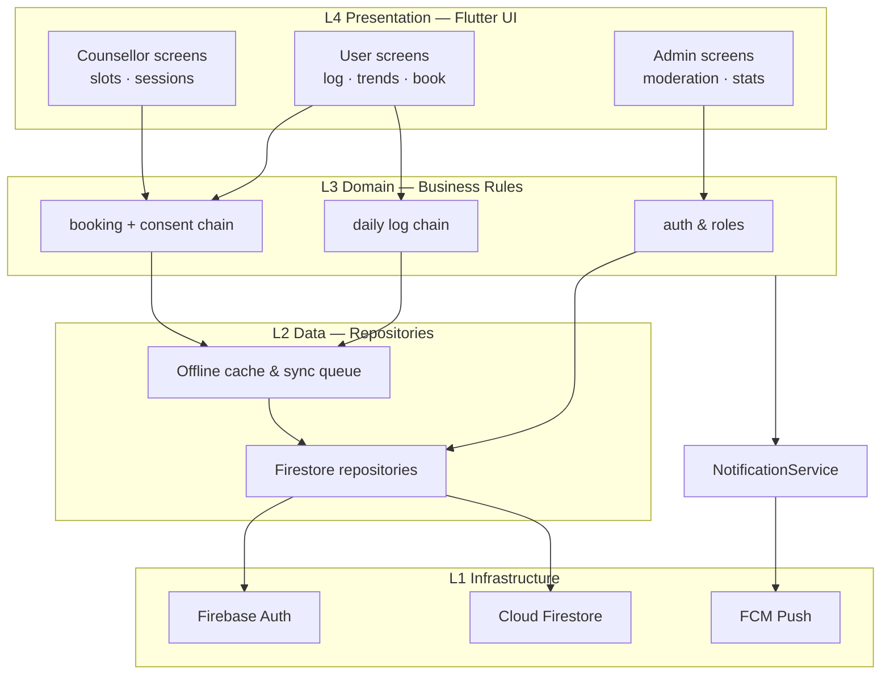
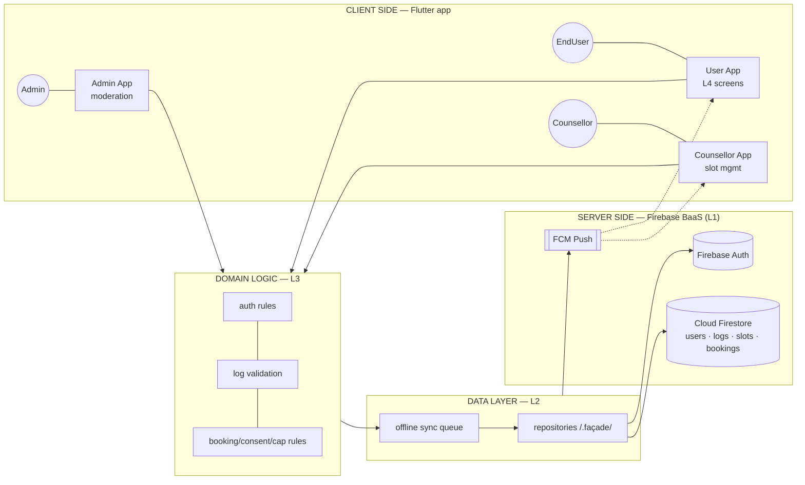

# Session 9: Software Architecture Design and Design Patterns

| Field | Details |
|---|---|
| **Course** | Software Development Project (SDP) |
| **Session** | 9 |
| **Topic** | Software Architecture Design and Design Patterns |
| **Deliverable** | System Architecture Diagram |
| **Industry Mapping** | System Architecture Planning |
| **Project Domain** | HealthCare |
| **Project Title** | Eunoia — Healthcare & Mental Wellness Platform |
| **GitHub Repository** | https://github.com/HarshBhardwaj00/Eunoia |
| **Input from Sessions 6–8** | Modules (M1–M8) + coupling/cohesion analysis → architecture layers & patterns |

---

## Objective

To raise the design from **module level (Session 8) to system level**: choose and
justify Eunoia's **architectural style** — layered architecture over a client–server
topology, understand **microservices** conceptually and argue the trade-off our scale
forces, and apply **proven design patterns** — ending with the deliverable: a complete
**System Architecture Diagram**.

**Learning Outcomes:**
1. Design a layered architecture with clear layer responsibilities & rules.
2. Understand client–server topology and place Eunoia in it.
3. Conceptually evaluate microservices vs monolith for our scale.
4. Identify and apply standard design patterns at specific project points.

---

## Part A: Layered Architecture Design

**Chosen style: Layered (n-tier) architecture** — industry's workhorse for data-driven
apps like ours; each layer depends only on the layer(s) below it.

### Eunoia's layers (roles from Sessions 6–8)

| Layer (top→bottom) | Responsibility | Contents | Depends on |
|---|---|---|---|
| **L4 — Presentation** | Screens, widgets, state, accessible UX (NFR-03: ≤ 3 taps) | Flutter UI (User/Counsellor/Admin screens) | L3 interfaces |
| **L3 — Domain/Business logic** | Rules & invariants: consent (FR-14), cap (FR-19), validation (FR-05) | `Booking`, `Slot`, `DailyLog`, `JournalEntry`… domain classes | L2 repositories |
| **L2 — Data/Repository** | Persistence abstraction, offline cache/sync (NFR-04) | Firestore wrapper repositories, FIFO sync queue | L1 SDK façade |
| **L1 — Infrastructure/Services** | Vendor SDKs & external systems | Firebase Auth, Firestore, FCM (façade-wrapped) | external |

### Layer rules (the discipline that makes layers work)

1. **Downward-only** dependency — L4 never calls L1 directly (from Session 8's coupling ban).
2. **Interface crossings** — layers talk through repository/service interfaces, not concrete SDK types.
3. **Invariants live in L3** — e.g., "max 1 booking per slot" is enforced once, presentation layer cannot bypass.
4. **L1 contains zero business rules** — vendor swap (Firebase → Supabase someday) touches only L1/L2.

---

## Part B: Client–Server Architecture

**Eunoia is a classic client–server system:**

| Side | Implementation | Notes |
|---|---|---|
| **Clients** | Flutter app running on users' Android devices (and web build) | stateless between launches; thin/smart hybrid — UI in client, rules in domain layer |
| **Server(s)** | Firebase managed servers: Auth, Firestore, FCM | **BaaS (Backend-as-a-Service)** — we rent correct, battle-tested servers |
| **Boundary** | HTTPS/TLS REST-realtime channels | NFR-01 encryption in transit |

**Why BaaS client–server (not our own server)?**
- Zero DevOps for a 2-person student team (operational feasibility of Session 2 ✅).
- Free Spark tier covers the pilot (economic feasibility ✅).
- Trade-off consciously accepted: **vendor lock-in ~ contained** to L1/L2 by the façade.

**Topology sketch:** `N clients → single logical backend (Firebase) → DB/datastore` —
the textbook 1:N client–server shape with cloud scale behind it.

---

## Part C: Microservices — Conceptual Evaluation

**Microservices:** decompose the system into independently deployable services, each
owning its data, talking over the network (HTTP/gRPC), scaling and failing separately.

### Conceptual mapping — *what Eunoia's services would look like* at industry scale

| Would-be service | Owns (data) | Scales independently because |
|---|---|---|
| identity-service | users, roles, sessions | login bursts at semester start |
| wellness-log-service | daily logs | write-heavy, grows with users linearly |
| booking-service | slots, bookings, consent | spiky evening/weekday load |
| counselling-service | conversations | long-lived connections, different tuning |
| notification-service | reminder schedules | async fan-out, isolated failure domain |
| admin/analytics-service | action logs, aggregates | read-heavy batch jobs |

### Our scale decision (conceptual only)

| Criterion | Microservices | Monolith (layered + BaaS) | Eunoia reality |
|---|---|---|---|
| Team size | needs many small teams + DevOps | one team | **2 students** |
| Operational cost | per-service infra & orchestration (k8s, service mesh) | near-zero (managed tier) | ₹0 budget |
| Deployment speed | independent pipelined releases | one release | weekly build enough |
| Failure isolation | strong | contained by layering since data-set is small | acceptable risk |
| **Verdict** | ❌ premature (but right later) | ✅ chosen | documented properly |

**Learning value preserved:** understanding the *seams* (Session 8's modules M1–M7 are
exactly the future service boundaries) means a later split is a **refactoring, not a
rewrite** — the honest way industry teams keep options open ("modular monolith now,
microservices when data/team grows").

---

## Part D: Design Patterns Applied (GoF + architecture patterns)

| Pattern | Type | Where in Eunoia | Solves |
|---|---|---|---|
| **Singleton** | Creational | `AuthService.currentSession`, Firestore wrapper instance | one authenticated entry point app-wide |
| **Factory Method** | Creational | role creation (`UserFactory.fromSession(role)`) | UI never hard-codes role classes |
| **Builder** | Creational | `DailyLogBuilder` (mood → sleep → stress → validate) | ensures no half-valid check-in enters L3 |
| **Repository** | Architectural (PoEAA) | `LogRepository`, `BookingRepository` vs Firestore | Session 8's data coupling at best grade |
| **Facade** | Structural | L1 wrappers over Firebase SDKs | vendor swap cost contained |
| **Adapter** | Structural | FCM → `NotificationPort` interface | messaging swap without UI change |
| **Observer / Streams** | Behavioral | trend charts listen to Firestore snapshots | auto-refresh without polling |
| **State** | Behavioral | `Slot`: `available → booked → deactivated` | FR-17 invariant encoded in type behavior |
| **Strategy** | Behavioral | consent check `Booking.summaryVisibleTo()` + reminder policies | FR-14 logic in one replaceable place |
| **MVC / MVVM-lite** | App pattern | L4 screens + L3 domain — chosen MVVM-flavored separation | clean presentation/domain split |

*(Each pattern cites: the GoF classification, the concrete hotspot in our class
diagram, and the SRS requirement it serves — patterns are tools, not decoration.)*

---

## Deliverable — System Architecture Diagram (Evidence Summary)

### Full architecture at one glance

| Checklist item | Status |
|---|---|
| 4-layer architecture with dependency rules (Part A) | ✅ |
| Client–server topology justified with BaaS trade-offs (Part B) | ✅ |
| Microservices conceptually mapped + honest scale verdict (Part C) | ✅ |
| 10 design patterns placed with requirement trace (Part D) | ✅ |
| Complete System Architecture Diagram (deliverable) | ✅ |
| Deliverable added to repository `SDP-Sessions/` folder | ✅ *(added locally this session)* |

---

## Industry Mapping — System Architecture Planning

| Our SDP practice | Industry equivalent |
|---|---|
| Layered rules enforced in review | "Screaming architecture"/clean-architecture code review gates |
| BaaS trade-off documented | CTO decision records (ADR — *architecture decision record*) |
| Modular monolith vs microservices deliberation | Exact debate at every startup's scale-up moment |
| Pattern placement table | Legacy-code onboarding map; patterns become shared vocabulary |
| Traceability FR → layer → pattern | Architecture RTM extends requirements RTM to system level |
| Diagram-as-code (Mermaid in repo) | Living architecture: C4Model culture, docs updated in same PR as code |

**Business reality:** architecture planning is where **cost, team skill, and scale
meet** — our documented "monolith now, microservices-ready seams" is the same answer a
pragmatic staff engineer gives a 2-person startup budgeted at ₹0 free-tier.

---

## Conclusion

Session 9 raised Eunoia's design to system level: a disciplined **4-layer architecture**
with downward-only dependencies, understood and justified **client–server topology**
via Firebase BaaS, evaluated **microservices conceptually** and honestly chose a
modular monolith for our scale (with service seams already mapped), and placed
**10+ design patterns** at concrete points each traced to an SRS requirement. The
System Architecture Diagram closes this documentation arc — Sessions 2–9 together form
a complete, industry-trackable design pipeline: *from one real-world problem to an
implemented-in-principle architecture*.
